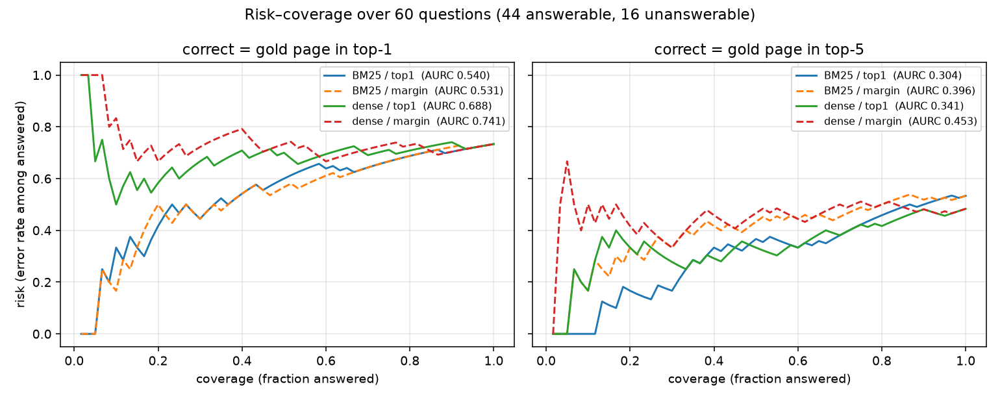

# Knowing When Not to Answer: Abstaining Retrieval over FAA Flight-Training Handbooks

A retrieval pipeline over two public FAA handbooks that cites an exact page for every passage
it returns, and measures whether it can tell when the handbooks do not support an answer at
all.

**Finding.** A plain BM25 score separates supported from unsupported questions with an AUROC
of 0.952 — higher than the dense retriever that beats it at finding passages (0.709). Answering
only the most confident half of the questions removes every unsupported answer. **The better
retriever is the worse abstainer**, and the reason is measurable: cosine similarity is bounded,
so a sentence encoder has no way to score "nothing here matches".

> Status: **v0.2** (started October 2026). The retrieval comparison, the abstention experiment
> and the risk-coverage analysis are complete; *Limitations* says what they do not cover.
> `pytest -q` passes 9 tests covering chunking, retrieval and the metrics.

## Motivation

A decision aid for pilots is only useful if pilots can calibrate how much to trust it. A
system that answers every question with the same confidence, including questions its sources
cannot support, invites over-trust. This project asks a small, measurable version of that
problem:

**Research question.** Given a question and a fixed body of authoritative documents, can a
retrieval system decide *when not to answer*, and how much does abstaining reduce the error
rate of the answers it does give?

## Data

- *Pilot's Handbook of Aeronautical Knowledge* (FAA-H-8083-25C) and *Airplane Flying
  Handbook* (FAA-H-8083-3C), published by the U.S. Federal Aviation Administration (U.S.
  government works). Download with `python -m src.download`.
- `data/questions.csv`: the evaluation set (60 questions: 44 answerable, 16 unanswerable).
  Questions were drafted with AI assistance against the two PDFs. Every cited page is a
  1-based PDF page, and `source_note` records the chapter, the printed handbook page, and
  the phrase the label rests on.
  - **How the labels were checked.** Each answerable row was verified programmatically: a
    distinctive phrase from the cited passage must appear on the cited page. Rows whose
    supporting passage also appears elsewhere in either handbook were narrowed or dropped, so
    that each question has one unambiguous source page. For the **unanswerable** rows, the
    absence was verified by searching both PDFs for the terms the answer would have to use;
    `source_note` records what was searched. All 60 rows were then checked against the PDFs
    by the author and accepted as they stand.
  - **Difficulty is mixed on purpose.** Some questions reuse the handbook's own term; others
    paraphrase it away entirely. This spread is what separates a lexical retriever from a
    dense one, but it also means the aggregate numbers depend on the mix, and subsets of this
    set are not comparable with each other.
- Only public civil-aviation material is used. No military or non-public data is involved.

## Method

1. **Chunking** (`src/chunk.py`): split PDF pages into overlapping word windows that never
   cross a page, so every answer can cite an exact page.
2. **Retrieval**: compare a lexical baseline, BM25 (`src/bm25_retriever.py`), with dense
   sentence embeddings (`src/dense_retriever.py`).
3. **Abstention** (`src/abstain.py`): turn the ranked retrieval scores into a confidence value
   — the top-1 score, or the top-1 minus top-2 margin — then answer only above a threshold.
4. **Evaluation** (`src/evaluate.py`): Recall@k for retrieval; the risk–coverage curve and its
   area (AURC) for selective answering.

## Results

Both handbooks together yield 926 pages with extractable text, which become 3,277 chunks
(200-word windows, 50-word overlap, never crossing a page). The evaluation set holds 60
questions: 44 answerable and 16 unanswerable. Recall is measured over the 44 answerable
questions; abstention is measured over all 60.

**Headline.** A retrieval score alone separates questions the handbooks support from
questions they do not, with an AUROC of 0.952, and at 50% coverage the system answers no
unsupported question at all.

### Retrieval: BM25 vs. dense

| Retriever | Recall@1 | Recall@5 |
|---|---|---|
| BM25 | 0.364 | 0.636 |
| Dense (`all-MiniLM-L6-v2`) | 0.364 | **0.705** |

Dense retrieval recovers 9 of the questions BM25 misses at Recall@5, and loses 6. The split is
sharp, and it runs along vocabulary: when the handbook's own term is absent from the
question, dense wins; when the term appears verbatim, BM25 wins.

- **Recovered** — Q012 asks *"which airspeed buys the most time in the air"*; the handbook
  calls it **minimum sink**. The question and the passage share almost no words.
- **Lost** — Q038 asks what an airplane needs "before the handbook will call it a complex
  airplane", quoting the term exactly. IDF puts BM25 straight on the page.

### Confidence: the better retriever is the worse abstainer

AUROC below is the probability that an answerable question receives a higher confidence
than an unanswerable one. 0.5 is chance; 1.0 is perfect separation.

| Retriever | top-1 score | margin |
|---|---|---|
| BM25 | **0.952** | 0.482 |
| Dense (`all-MiniLM-L6-v2`) | 0.709 | 0.514 |

**Why margin fails.** Overlapping windows make the first and second hit near-duplicates of
each other. In 17 of the 60 questions (28.3%) the top two chunks come from the same page,
and the top-2 score averages 0.935 of the top-1 score. The margin therefore measures how
redundant the corpus is at that point, not how confident the retriever is. A chunking
decision made for citation accuracy is what breaks this confidence signal.

**Why BM25 beats dense here.** The two scores live on different scales.

| | mean top-1, answerable | mean top-1, unanswerable | ratio |
|---|---|---|---|
| BM25 | 57.7 | 32.3 | **1.79** |
| Dense | 0.601 | 0.535 | **1.12** |

Cosine similarity is bounded in [-1, 1], and all 60 questions land in a narrow band between
0.47 and 0.70. A sentence encoder always finds something semantically nearby, so it has no
way to express "nothing here matches". BM25's IDF-weighted score is open above, and it
falls to the floor when the query terms are rare in the corpus.

Each retriever therefore has its own strengths and weaknesses, and the practical conclusion
is to use whichever fits the job at hand: dense retrieval to find the passage, the BM25
score to decide whether to answer at all.

### Selective answering: risk and coverage

| Retriever | Confidence | Correct if gold page in | AURC |
|---|---|---|---|
| **BM25** | **top-1** | **top-5** | **0.304** |
| Dense | top-1 | top-5 | 0.341 |
| BM25 | margin | top-5 | 0.396 |
| BM25 | top-1 | top-1 | 0.540 |



*Each curve sweeps every confidence threshold at once: the point at coverage c is the error
rate when only the c most confident questions are answered. The left panel counts an answer
correct only if the gold page is ranked first; the right panel allows it anywhere in the top 5.*

AURC summarises the whole curve, but it hides which kind of error is being traded away.
Splitting the same run by outcome shows that:

| Coverage | Answered | Correct | Wrong | Unsupported answered | Correctly abstained | Missed |
|---|---|---|---|---|---|---|
| 100% | 60 | 28 | 16 | **16** | 0 | 0 |
| 75% | 45 | 26 | 15 | 4 | 12 | 3 |
| **50%** | 30 | 19 | 11 | **0** | 16 | 14 |
| 25% | 15 | 13 | 2 | 0 | 16 | 29 |

At 50% coverage the system answers no unsupported question at all, and below that point no
further safety is bought — the only thing that changes is that questions the handbooks do
answer go unanswered. Risk at 25% coverage is 0.133, but that is 2 errors out of 15
answered questions, so single questions move it by 0.067.

## Limitations

1. **Chunks stop at page boundaries.** Every chunk is confined to one page so that a
   retrieved passage maps to exactly one citable page. The cost is that evidence split
   across a page break is never available intact: 213 of 868 body pages (24.5%) end
   mid-sentence.

2. **The dense model silently truncates long chunks.** `all-MiniLM-L6-v2` accepts 256
   tokens, but a 200-word chunk of handbook prose runs to a median of 247 tokens and 30%
   of chunks exceed the limit. The overflow is dropped with no warning, so for those
   chunks the dense retriever never sees the tail.

3. **The question set has had one reviewer.** Labels were checked programmatically and then
   against the PDFs by the author, but by one person only. A second reviewer is the obvious
   next check, particularly for difficulty, which is a judgement call rather than a fact.

4. **Subsets of the question set are not comparable.** Difficulty is mixed on purpose, and the
   mix is uneven across the set: Recall@1 is 0.227 on the first 22 answerable questions and
   0.500 on the next 22 — a difference in the questions, not in the retriever.

5. **This is retrieval, not answer generation.** The system returns passages; it never
   writes an answer. "Correct" means the gold page was retrieved, not that a correct
   answer was produced.

6. **Coverage trades one failure against another, and the numbers thin out as it falls.**
   Raising coverage means answering more questions the corpus does not support; lowering it
   means staying silent on questions it does. The crossover sits near 50%, as the table above
   shows. Below that the sample also thins: 15 questions are answered at 25% coverage, where a
   single question moves risk by 0.067. Improving on the crossover would require judging the
   intent of the question and the content of the supporting passage more finely than a
   retrieval score can.

7. **Risk does not count the cost of abstaining.** Risk is the error rate among answered
   questions only, so a system that answers nothing scores a perfect 0. The four-outcome
   table is reported alongside it for that reason.

8. **Compound (multi-hop) questions are out of scope.** `gold_page` holds a single page,
   so a question whose evidence spans two pages can be neither labelled nor scored. The
   question set was built from single-page evidence throughout.

9. **What counts as "unanswerable" is a function of the corpus.** Every answer must rest on
   these two handbooks, so a question whose evidence lives elsewhere cannot be answered however
   reasonable it is to ask. Of the 16 unanswerable questions, only 2 — both asking for real-time
   information — could not be answered by any fixed document; the other 14 are covered by other
   FAA publications or by manufacturer documentation.

## Future work

This project tests a measuring instrument rather than a finished system. It was built on a
deliberately limited corpus and question set, and its aim was to locate the boundary where the
evidence runs out and to see whether that boundary can be detected. Every corpus has such a
boundary, and a system meant to be trusted has to recognise it and act on it.

Three directions follow from the measurements above, in the order I would take them.

1. **Reranking, where the headroom is already measured.** Recall@1 is 0.364, but the gold page
   is inside the top 20 of the two retrievers combined for **93.2%** of questions. The right
   passage is almost always retrieved and almost never ranked first, which is a reranking
   problem rather than a retrieval one. A cross-encoder over those candidates is the obvious
   next experiment, and its score becomes a third confidence signal to test against the 0.952
   that BM25 already reaches with top-1 alone.
2. **Compound questions.** Supporting evidence that spans two pages needs a multi-page label
   and a scoring rule to match, which in turn needs a question set built for it. That is a
   change to the measuring instrument, not an addition to the pipeline, which is why it sits
   outside this version.
3. **A confidence signal that reads the passage, not just the score.** The crossover at 50%
   coverage is the limit of what a scalar retrieval score can do. Going past it means judging
   whether the retrieved text actually answers the question asked — the point at which this
   becomes a calibration problem rather than a ranking one.

Fusing the two retrievers was tried and is reported here as a negative result: reciprocal rank
fusion raised Recall@5 to 0.773 but dropped Recall@1 to 0.295, below either retriever alone.
With only two systems, fusion widens the candidate pool and blurs the top of it.

## How to run

Chunking, BM25, evaluation and the plots run in the main environment:

```bash
# macOS:   bash setup_mac.command      Windows: double-click setup_windows.bat
# (or manually)
python3 -m venv .venv && source .venv/bin/activate
pip install -r requirements.txt
python -m src.download
pytest -q
```

Dense retrieval needs a second environment. The last PyTorch release with Intel-macOS
wheels is 2.2.2, which supports Python 3.8-3.12 only, while the main environment runs
3.13 — so on an Intel Mac the two cannot be merged. On Apple Silicon or Linux, install
`requirements-dense.txt` into the main environment and ignore this step.

```bash
conda create -n dense python=3.12 -y
conda run -n dense pip install -r requirements-dense.txt
```

PyMuPDF has no Python 3.12 x86-macOS wheel, so the dense environment cannot read the
PDFs: export the chunks from the main environment as JSON and load them there.

## Authorship and AI assistance

I am teaching myself computer science alongside a demanding full-time job, without access to
anyone who could advise me on this field or read my code with me. An AI assistant (Claude) was
the only form of tutoring available to me, and I used it throughout this project. For that
reason I would rather state precisely what it did than leave it unsaid.

**I** wrote every core module — chunking, retrieval, abstention, evaluation — myself. For each
function I studied a reference implementation and the reasoning behind it, closed it, and wrote
my own version against the tests. I ran every experiment, decided what to measure, and wrote
the analysis, including the findings above and the limitations that qualify them. All
implementation commits are my own.

**The assistant** proposed the project structure, wrote the setup utility (`src/download.py`)
and the unit-test specifications in `tests/`, drafted the seed questions and located their
supporting pages in the PDFs, explained the design decisions behind each module, **showed me a
reference implementation of each core function**, and reviewed my code.

**The evaluation set was built differently from the code, so I will describe it separately.** I
set its design: which chapters to draw from, that every question must rest on one unambiguous
source page, that answerable questions must paraphrase rather than quote the handbook, and
what kinds of question belong in the unanswerable half. The assistant then drafted questions
to that specification, located their supporting pages, and ran the programmatic checks
described under *Data*. I checked all 60 rows against the PDFs myself and accepted the set as
it stands. The questions are therefore mine by design and by review, and the assistant's by
first draft.
